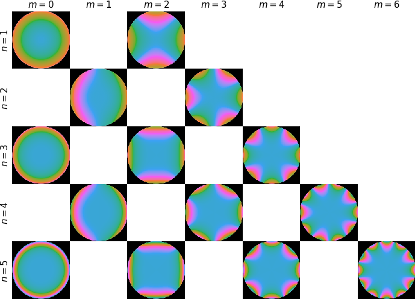
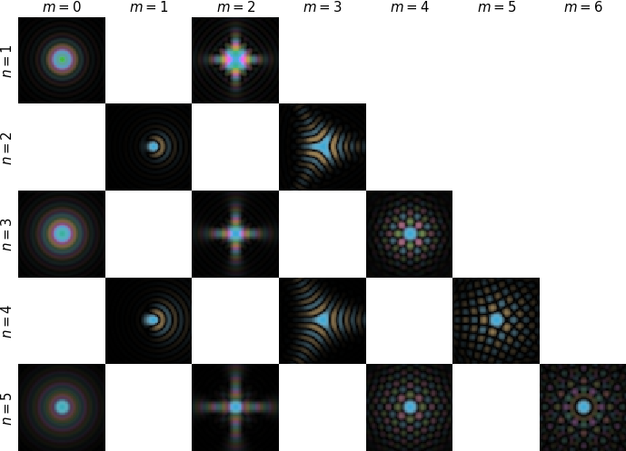

(wave-aberrations)=
## Wave Aberrations

An ideal lens forms a spherical wave converging on or emerging from a single point. This means that a plane wave will be converted to a spherical wave converging at the focal point of the lens, and the image of a point source is also a point. In STEM we want the objective lens to produce the smallest possible probe and in HRTEM we want the objective lens to produce a perfect magnified image of the sample. In most cases, both of these objectives require that we minimize all aberrations as much as possible. 

While the last decades have seen enormous improvements in the optics of electron microscopes, S/TEMs are far from ideal optical systems. Imperfections cause the focused wave front to deviate from the ideal spherical surface. 

### Contrast Transfer and the Point-Spread Function

This deviation is typically expressed as a phase error or the aberration function, $\chi(\bm{k})$. Given a Fourier space wavefunction $\Psi_0(\bm{k})$ entering the lens, the wavefunction after passing through that lens can thus be expressed as 
```{math}
    \Psi(\bm{k}) = \Psi_0(\bm{k}) \mathrm{e} ^ {-i \chi(\bm{k})}.
```

Another, possibly more intuitive way of framing the phase error is the point spread function 
```{math}
    \mathrm{PSF}(\bm{r}) = \mathscr{F}^{-1}_{\bm{k} \rightarrow \bm{r}}\left\{ \mathrm{e} ^ {-i \chi(\bm{k})} \right\} ,
```
the point spread function describes how an imaging system responds to a point source. In STEM, the PSF would be the image of the probe, given an infinite objective aperture, in HRTEM the PSF would be how a perfect point source is imaged by an objective lens with an infinite collection angle.

The phase error can be expressed in different ways, however, it is traditionally written as a series expansion. One popular choice is to write it as an expansion in polar coordinates
```{math}
    \chi(k, \phi) = \frac{2 \pi}{\lambda} \sum_{n,m} \frac{1}{n + 1} C_{n,m} (k \lambda)^{n+1} \cos\left[m (\phi - \phi_{n,m}) \right] ,
```
where $k$ is the Fourier space radial coordinate and $\phi$ is the corresponding azimuthal coordinate. The coefficient $C_{n,m}$ represents the magnitude of an aberration and $\phi_{n,m}$ gives a direction to that aberration. There are other ways of representing the aberration function, you might have seen the Cartesian representation where some parameters have an "a" and "b" version.

The most common aberrations have well-known names, which are listed in [](#tab:aberrations) together with the alternative notation of {cite:t}`krivanek_towards_1999`. 
The radial order $n$ sets how quickly each aberration grows with scattering angle, while the azimuthal order $m$ sets its rotational symmetry; for example, an aberration with $m=3$ has three-fold symmetry.

:::{list-table} Common aberration coefficients in the polar notation used in this article, the equivalent notation of {cite:t}`krivanek_towards_1999`, and their names.
:label: tab:aberrations
:header-rows: 1

* - $C_{n,m}$
  - Krivanek
  - Name
* - $C_{1,0}$
  - $C_1$
  - Defocus
* - $C_{1,2}$
  - $A_1$
  - Two-fold astigmatism
* - $C_{2,1}$
  - $B_2$
  - Axial coma
* - $C_{2,3}$
  - $A_2$
  - Three-fold astigmatism (trefoil)
* - $C_{3,0}$
  - $C_3$
  - Third-order spherical aberration ($C_s$)
* - $C_{3,2}$
  - $S_3$
  - Axial star aberration
* - $C_{3,4}$
  - $A_3$
  - Four-fold astigmatism (quadrafoil)
* - $C_{4,1}$
  - $B_4$
  - Fourth-order axial coma
* - $C_{4,3}$
  - $D_4$
  - Three-lobe aberration
* - $C_{4,5}$
  - $A_4$
  - Five-fold astigmatism (pentafoil)
* - $C_{5,0}$
  - $C_5$
  - Fifth-order spherical aberration
* - $C_{5,6}$
  - $A_5$
  - Six-fold astigmatism (hexafoil)
:::

#### Visualizing the CTF and PSF

Below we visualize each aberration by mapping the phase to different colors. We can also visualize each phase aberration by showing its effect on a small probe wave function using the PSF. Note that the magnitudes of the aberrations shown are scaled with their radial order $n$ according to a power law, so that each aberration produces a similar phase error at the edge of the plot.

````{tab-set}
```{tab-item} CTF

```
```{tab-item} PSF

```
````

We can also visualize this interactively as shown in [](#fig_ctf_psf), where the sliders control the defocus, two-fold astigmatism, axial coma, three-fold astigmatism, and third- and fifth-order spherical aberration.

```{figure} #app:ctf_psf
:name: fig_ctf_psf
:placeholder: ./figures/ctf_psf.png
**Interactive widget showing the influence of common aberrations on the point spread function (PSF) and contrast transfer function (CTF).**
```

### Aperture

In practice, the maximum transferred frequency is limited by the aperture of the objective lens. This is conventionally described as a multiplication with the aperture function:

$$
    \psi_{\mathrm{image}}(k, \phi) = A(k) \exp[-i \chi(k, \phi)] \psi_{\mathrm{exit}}(k, \phi),
$$

where $A(k)$ is the aperture function

$$
    A(k) = \begin{cases} 1 & \text{if } k \leq k_{cut} \\ 0 & \text{if } k > k_{cut} \end{cases} .
$$

We typically cut off the `CTF` at the angle corresponding to the Scherzer [point resolution](https://en.wikipedia.org/wiki/High-resolution_transmission_electron_microscopy#Scherzer_defocus), which is defined as the angle where the phase of the `CTF` crosses the abscissa for the first time (`crossover_angle`).

(partial-coherence)=
### Partial Coherence (Quasi-Coherent)
So far we have assumed perfectly coherent illumination, where every electron has exactly the same energy and incident direction. 
In a real microscope, the electrons have a small spread of energies, and a small spread of incident directions or source positions. 
Each electron only interferes with itself, and so the measured image is an incoherent sum of the images formed by electrons with slightly different energies and directions. 
The result is a loss of contrast, which mostly affects high spatial frequencies. 
We divide partial coherence into two parts.

**Spatial coherence** describes the spread of incident directions (in TEM) or of source positions (in STEM) of the electrons. 
Its main source is the finite size of the electron source, as imaged onto the specimen by the condenser lenses. 
Mechanical vibrations, drift, and stray electromagnetic fields which move the beam relative to the specimen during an exposure have a similar effect, and increase the effective source size {cite:p}`dwyer_measurement_2010`. 
In STEM, the effective source size blurs the image, which we approximate by convolving simulated STEM images with a Gaussian in [](#stem-image-simulation).

**Temporal coherence** describes the spread of electron energies. 
Electrons with different energies are focused at different heights by the chromatic aberration $C_c$ of the objective lens, which produces a spread of defocus values. 
The root-mean-square focal spread is approximately {cite:p}`kirkland2020`
```{math}
:label: eq:focal_spread
\Delta = C_c \sqrt{\left(\frac{\Delta E}{e E_0}\right)^2 + \left(\frac{\Delta V}{V}\right)^2 + \left(\frac{2 \Delta I}{I}\right)^2},
```
where $\Delta E$ is the energy spread of the electron source, $E_0$ is the accelerating voltage, and $\Delta V / V$ and $\Delta I / I$ are the fractional instabilities of the high voltage supply and of the objective lens current. 
We refer to the resulting blur as temporal incoherence. 
Because the defocus term of the aberration function is proportional to $k^2$, temporal incoherence damps high spatial frequencies very strongly, and it often sets the information limit of HRTEM images.

Similar to the aperture function, partial coherence dampens the high spatial frequencies of the signal. Partial coherence may be approximated by multiplying the `CTF` by envelope functions:

$$
    \psi_{\mathrm{image}}(k, \phi) = \mathrm{CTF}(k, \phi) \psi_{\mathrm{exit}}(k, \phi),
$$

where the $\mathrm{CTF}$ is now given as

$$
    \mathrm{CTF}(k, \phi) = E_t(k) E_s(k) A(k) \exp[-i \chi(k, \phi)]
$$

and $E_t(k)$ and $E_s(k)$ are the temporal and spatial envelopes, respectively. For a Gaussian distribution of defocus values with root-mean-square focal spread $\Delta$, the temporal envelope is $E_t(k) = \exp\left[-\frac{1}{2}\left(\pi \lambda \Delta k^2\right)^2\right]$ {cite:p}`kirkland2020`, while the spatial envelope depends on the gradient of the aberration function $\chi(\bm{k})$ and on the angular spread of the illumination (see the [abTEM documentation](https://abtem.github.io/doc/user_guide/walkthrough/contrast_transfer_function.html#partial-coherence-quasi-coherent) for more detail). Note that the `focal_spread` and `angular_spread` parameters in *ab*TEM, which we use for the interactive figures, follow the convention of {cite:t}`kirkland2020` and give the $1/e$ half-width of each distribution, which is $\sqrt{2}$ times its standard deviation.

### Spherical-Aberration Limited Contrast Transfer

For an uncorrected microscope the dominant aberration is the third order spherical aberration ($C_{3,0}$). Assuming the other non-symmetric components have been well aligned by the user, the contrast transfer function simplifies to:
```{math}
    \chi(k) \approx \frac{2\pi}{\lambda}\left( -\frac{\lambda^2 k^2}{2} \Delta f + \frac{\lambda^4 k^4}{4} C_s \right) \quad .
```
Here we used the common aliases of the aberration coefficients, so $\Delta f = -C_{1,0}$ is the defocus and $C_s = C_{3,0}$ is the third order spherical aberration.

#### Visualizing the Contrast Transfer Function

The contrast transfer function can also be plotted as a line profile, which *by convention* displays the imaginary part of the complex exponential of the phase error. The horizontal axis denotes a specific spatial frequency, while the vertical axis shows how the contrast at that spatial frequency is transferred.

Below in [](#fig_ctf_line), we visualize the CTF interactively for different primary beam energies, defocus values, spherical aberration, aperture cutoff, and temporal and spatial incoherences.

```{figure} #app:ctf_line
:name: fig_ctf_line
:placeholder: ./static/ctf_line.png
**Interactive widget showing the influence of common coherent and incoherent parameters on the contrast transfer function (CTF).**
```